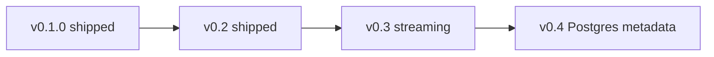

# Roadmap

What is **done in v0.1**, what is **next**, and what we are **not** building.

Status markers:

| Marker | Meaning |
|--------|---------|
| ✅ | Shipped in current tree |
| 🚧 | Started / partial |
| 📋 | Planned |
| ⛔ | Explicitly out of scope |

---

## v0.1 — foundation

Core embeddable CAS layer with cross-language on-disk format.

| Area | Status | Notes |
|------|--------|-------|
| Rust core: fixed + CDC chunking | ✅ | Streaming ingest via `Read` |
| SHA-256 digests, verify on read | ✅ | Full 64-char hex keys |
| Manifests + refcount + GC | ✅ | JSON metadata on backend |
| Rust `FsBackend` | ✅ | |
| C-API / FFI | ✅ | `core/include/chunkstore.h` |
| Python wrapper (PyO3 / maturin) | ✅ | `FilesystemBackend` |
| Python `S3Backend` | ✅ | MinIO integration tests in CI (`python-s3` job) |
| Go wrapper (cgo) | ✅ | `FilesystemBackend`, `S3Backend` (aws-sdk-go-v2) |
| 9 functional scenarios (Rust) | ✅ | `core/tests/scenarios.rs` |
| Python scenario tests | ✅ | All 9 scenarios |
| Go unit tests | ✅ | |
| Cross-language test | ✅ | Python write → Go read/delete → Python stats |
| FastAPI example | ✅ | `examples/fastapi/` |
| FastAPI backup example | ✅ | `examples/fastapi-backup/` — gzip dumps + date catalog |
| Workload analysis + benches | ✅ | `workload_analysis`, criterion benches |
| CI (Rust, Python, Go, cross-lang, S3/MinIO, deny/audit) | ✅ | `.github/workflows/ci.yml` |
| README + CONTRIBUTING + charts | ✅ | |
| PyPI publish workflow | ✅ | `.github/workflows/pypi.yml` — trusted publisher + release deploy |
| PyPI package live | ✅ | [`chunkstore` on PyPI](https://pypi.org/project/chunkstore/) |
| Go HTTP example | ✅ | `examples/go-http/` |
| Public GitHub repo | ✅ | [github.com/MuratovER/chunkstore](https://github.com/MuratovER/chunkstore) |
| Dogfood in document service | 📋 | PDF versions / scans / templates |

---

## v0.2 — distribution & backends

Polish packaging and make S3 + Go production-usable.

### Publishing

| Task | Priority | Details |
|------|----------|---------|
| First PyPI release | ✅ | `v0.1.0` — [pypi.org/project/chunkstore](https://pypi.org/project/chunkstore/) |
| Fix README / badge URLs | ✅ | Links point to `MuratovER/chunkstore` |
| macOS + Windows wheels | ✅ | `pypi.yml`: Linux + macOS universal2 + Windows x64 (abi3) |
| TestPyPI smoke in CI | Low | Optional manual `workflow_dispatch` before each release |
| crates.io crate `chunkstore-core` | ✅ | `.github/workflows/crates-io.yml`; [docs/CRATES.md](CRATES.md) |
| Go module tagging | ✅ | `go get github.com/MuratovER/chunkstore/go@v0.3.0` |

### Backends & examples

| Task | Priority | Details |
|------|----------|---------|
| Go `S3Backend` | ✅ | aws-sdk-go-v2; MinIO tests in CI (`go-s3` job) |
| S3 integration tests | ✅ | MinIO service in CI (`python-s3` job) |
| S3 backend hardening | ✅ | Retries, timeouts; `ListChunkKeys` / `list_chunk_keys` |
| `examples/go-http/` | ✅ | Upload / download / delete / stats over HTTP |
| S3 usage docs | ✅ | [docs/S3.md](S3.md) — layout, IAM, MinIO |

### API & docs

| Task | Priority | Details |
|------|----------|---------|
| CDC benchmark docs | ✅ | [docs/CHUNKING.md](CHUNKING.md) + `workload_analysis` |
| Python API polish | ✅ | `ingest` ↔ `upload_file` aliases in docstrings |
| Go `IngestReader` / path helpers | ✅ | `IngestFixed`, `IngestFile`, digest return |
| CHANGELOG.md | ✅ | [CHANGELOG.md](../CHANGELOG.md) |

---

## v0.3 — streaming & async

Large files and async Python services without loading full blobs in memory.

| Task | Priority | Details |
|------|----------|---------|
| Streaming **read** | High | ✅ `read_to_writer` in Rust; `chunkstore_read_to_writer` C-API |
| Streaming read in Python | High | ✅ `read_to_writer`, `read_to_path`, `iter_chunks`, async `iter_chunks` |
| Streaming read in Go | Medium | ✅ `ReadTo(io.Writer)` |
| Async Python API | Medium | ✅ `AsyncChunkStore`, `AsyncChunkClient`, `AsyncS3Backend` |
| Streaming **ingest** | High | ✅ `ingest_reader` / `ingest_path` (Rust, FFI, Python, Go); Python `ingest_aiter` |
| Python quality in CI | ✅ | `python-quality` job: `ruff` + `mypy --strict` |
| Performance pass | Medium | ✅ Stream ingest (no full-file `Vec`); refcount stores size (no blob GET for GC); ingest commits new chunks before releasing old |
| Fuzz CDC + fixed chunkers | Low | ✅ `core/fuzz` (`cargo fuzz run fixed_chunker` / `cdc_chunker`) |

---

## v0.4+ — scale & enterprise hooks

Multi-instance and optional encryption — only with a clear design. See [CONSISTENCY.md](CONSISTENCY.md).

| Task | Priority | Details |
|------|----------|---------|
| Consistency model doc | High | ✅ [docs/CONSISTENCY.md](CONSISTENCY.md) |
| Distributed metadata | High | ✅ Postgres (`--features postgres`, `ChunkStore::open_postgres`) |
| Encryption at rest hooks | Medium | ✅ `ChunkCodec` / `open_with_codec` (plaintext digest, blob transform) |
| Compaction / FSCK | Medium | ✅ `ChunkStore::fsck(repair)` |
| Observability | Medium | ✅ `Stats.gc_chunks`; Postgres `stats()` from SQL aggregates |
| docs site | Low | MkDocs or similar; API reference generated from Rust/Python |

---

## Repository & CI hygiene

| Task | Status | Notes |
|------|--------|-------|
| Pre-commit: fmt, test, deny, clippy | ✅ | |
| `mypy` / `ruff` in pre-commit or CI | ✅ | `ruff` in pre-commit; `mypy` in CI `python-quality` |
| Criterion benches in CI (threshold) | 📋 | Optional regression guard |
| Dependabot / Renovate | ✅ | `.github/dependabot.yml` |
| Issue templates + PR template | ✅ | `.github/ISSUE_TEMPLATE/`, `PULL_REQUEST_TEMPLATE.md` |
| LICENSE headers | 📋 | Optional; MIT is in root |
| Security policy (`SECURITY.md`) | ✅ | [SECURITY.md](../SECURITY.md) |

---

## Explicitly out of scope

| Item | Why |
|------|-----|
| Backup CLI (Restic/Borg/Kopia competitor) | Library, not a product |
| S3 gateway / reverse proxy | Client SDK + explicit backend |
| Perceptual / similarity dedup | Byte-identical only |
| UI / admin console | Embeddable layer |
| Built-in encryption product | Hooks only in v0.4+ |
| Multi-node without shared metadata | Unsafe refcount — needs v0.4 design |

---

## Suggested order (next 3 milestones)

1. ~~**Ship v0.1.0**~~ — PyPI `0.1.0`, public repo, CI, S3 backends.
2. ~~**v0.2**~~ — crates.io workflow, Go module + API parity, S3 docs/hardening, CHANGELOG.
3. ~~**v0.3**~~ — streaming read + async Python + streaming ingest. ✅
4. **v0.4** — Postgres metadata shipped in-tree (`--features postgres`); docs site still open.

---

## How to use this doc

- Pick an item marked 📋 or 🚧 and open a GitHub issue before large PRs.
- When something ships, update this file in the same PR.
- Breaking on-disk format changes need a version bump and migration note — see [CONTRIBUTING.md](../CONTRIBUTING.md#on-disk-format-do-not-break-silently).
